# 🛒 NovaShop — Cloud-Native E-Commerce Single Page Application

[](https://github.com/paramdesai24/devops-cicd-basic/actions/workflows/cicd.yml)

A high-performance, containerless **E-Commerce Single Page Application (SPA)** with an automated Continuous Integration and Continuous Deployment (CI/CD) pipeline built using **GitHub Actions** (without Docker).

---

## ✨ Features

- **Rich E-Commerce Experience**:
  - **Product Catalog**: Live browsing with category filtering (Audio, Wearables, Accessories) and instant real-time search.
  - **Interactive Cart**: Slide-over drawer with item increment/decrement, subtotal, tax calculation, and removal.
  - **Coupon / Promo Code Engine**: Instant discount calculation (e.g., promo code `DEVOPS10` for 10% off).
  - **Express Checkout**: Modal with customer details, payment method selection, and order confirmation receipt generation.
  - **Toast Notifications**: Smooth visual feedback for user actions.
- **Automated CI/CD Pipeline (GitHub Actions)**:
  - **Continuous Integration (CI)**: Automated code checkout, Node.js environment setup, dependency installation, syntax checks, and unit/integration testing on `ubuntu-latest`.
  - **Continuous Deployment (CD)**: Automatically triggers upon commit to `main`, executes smoke tests, and deploys the application dashboard.
- **Zero Docker Overhead**: Runs directly on bare-metal GitHub Actions runners with lightning-fast execution times (~30 seconds).

---

## 🏗️ Pipeline Architecture

```mermaid
flowchart LR
    A[👨‍💻 Push to main] --> B[GitHub Repository]
    B --> C[CI Stage: Build & Test]
    subgraph CI [Continuous Integration]
        C --> C1[Checkout Repository]
        C1 --> C2[Setup Node.js 22 Runtime]
        C2 --> C3[Install Dependencies]
        C3 --> C4[Run 6 Automated API Tests]
        C4 --> C5[Archive Build Artifact]
    end
    C5 --> D[CD Stage: Deploy]
    subgraph CD [Continuous Deployment]
        D --> D1[Pre-flight Smoke Test]
        D1 --> D2[Deploy SPA to GitHub Pages]
        D2 --> D3[Audit & Verification Log]
    end
    D3 --> E[🎉 Production Live]
```



---

## 🔌 API Endpoints

| Method | Endpoint | Description |
|---|---|---|
| `GET` | `/` | Serves the E-Commerce Single Page Application |
| `GET` | `/api/products` | Retrieve all products (supports `?category=` and `?search=`) |
| `GET` | `/api/products/:id` | Fetch details for a specific product |
| `POST` | `/api/orders` | Place a new order with validation |
| `GET` | `/health` | Cloud-Native liveness probe for monitoring |
| `GET` | `/api/info` | Application metadata and telemetry |

---

## 💻 Local Development

### 1. Clone the repository
```bash
git clone https://github.com/paramdesai24/devops-cicd-basic.git
cd devops-cicd-basic
```

### 2. Install dependencies
```bash
npm install
```

### 3. Run automated tests (CI locally)
```bash
npm test
```

### 4. Start the application
```bash
npm start
```
Open [http://localhost:3000](http://localhost:3000) in your browser.
