# 🚀 Cloud-Native CI/CD Pipeline (GitHub & GitHub Actions)

[](https://github.com/paramdesai24/devops-cicd-basic/actions/workflows/cicd.yml)

A lightweight, simple, and containerless Continuous Integration and Continuous Deployment (CI/CD) pipeline for a cloud-native Node.js application built using **GitHub** and **GitHub Actions** (without Docker).

---

## 📋 Features

- **No Docker Required**: Runs directly on bare-metal GitHub Actions runners (`ubuntu-latest`) with Node.js runtime for ultra-fast execution (~30 seconds).
- **Continuous Integration (CI)**:
  - Automated repository checkout.
  - Dependency caching and verification.
  - Native unit and integration testing via `node:test` and `node:assert` (zero heavy external test runners).
  - Code syntax validation.
  - Build artifact packaging and archiving.
- **Continuous Deployment (CD)**:
  - Triggered automatically on push to the `main` branch upon successful CI.
  - Smoke tests and pre-deployment health verification.
  - Production deployment tracking and environment reporting.
  - Deploys application dashboard to GitHub Pages.
- **Cloud-Native Design (12-Factor App)**:
  - **Environment parity**: Port and environment configured via `process.env`.
  - **Health Probes**: Dedicated `/health` (liveness probe) and `/ready` (readiness probe) endpoints.
  - **Graceful Lifecycle**: Handles `SIGTERM` and `SIGINT` signals for zero-downtime termination.

---

## 🏗️ Pipeline Architecture

```mermaid
flowchart LR
    A[👨‍💻 Git Push to main] --> B[GitHub Repository]
    B --> C[CI Stage: Build & Test]
    subgraph CI [Continuous Integration]
        C --> C1[Checkout Code]
        C1 --> C2[Setup Node.js 22]
        C2 --> C3[Install Dependencies]
        C3 --> C4[Run Automated Tests]
        C4 --> C5[Archive Build Artifact]
    end
    C5 --> D[CD Stage: Deploy]
    subgraph CD [Continuous Deployment]
        D --> D1[Pre-flight Smoke Check]
        D1 --> D2[Production Deployment]
        D2 --> D3[Deploy Dashboard]
    end
    D3 --> E[🎉 Production Ready]
```



---

## 📁 Project Structure

```
├── .github/
│   └── workflows/
│       └── cicd.yml         # GitHub Actions CI/CD Pipeline specification
├── public/
│   └── index.html           # Cloud-native status dashboard & live endpoint tester
├── src/
│   ├── app.js               # Express application with cloud-native probes
│   └── server.js            # Server entrypoint with graceful shutdown
├── test/
│   └── app.test.js          # Automated unit & integration tests
├── .gitignore               # Ignored files (node_modules, logs)
├── package.json             # Application metadata and scripts
└── README.md                # Documentation and workflow guide
```

---

## 🔌 API Endpoints & Health Probes

| Method | Endpoint | Description | Cloud-Native Purpose |
|---|---|---|---|
| `GET` | `/` | Web Status Dashboard | User & operator UI |
| `GET` | `/health` | Application Liveness Probe | Kubernetes / Cloud Health Monitoring |
| `GET` | `/ready` | Application Readiness Probe | Ingress traffic routing readiness |
| `GET` | `/api/info` | Application Metadata & Uptime | Telemetry and environment diagnostics |

---

## 💻 Local Development

### Prerequisites
- Node.js (version 18, 20, or 22)
- Git

### 1. Clone the repository
```bash
git clone https://github.com/paramdesai24/devops-cicd-basic.git
cd devops-cicd-basic
```

### 2. Install dependencies
```bash
npm install
```

### 3. Run automated tests (CI locally)
```bash
npm test
```

### 4. Start the application
```bash
npm start
```
The server will start on `http://localhost:3000`.

---

## ⚙️ Enabling GitHub Pages (Optional for Live CD Web Dashboard)

To enable live hosting of the web dashboard via the CD job:
1. In your GitHub repository, navigate to **Settings** > **Pages**.
2. Under **Build and deployment** > **Source**, select **GitHub Actions**.
3. Any push to `main` will automatically build and publish the live dashboard.
