# 🛒 NovaShop — Cloud-Native E-Commerce SPA with Docker CI/CD

[](https://github.com/paramdesai24/devops-cicd-basic/actions/workflows/cicd.yml)

A high-performance **E-Commerce Single Page Application (SPA)** with a containerized Continuous Integration and Continuous Deployment (CI/CD) pipeline built using **Docker**, **GitHub Actions**, and **GitHub Container Registry (GHCR)**.

---

## ✨ Features

- **Rich E-Commerce Experience**:
  - **Product Catalog**: Live browsing with category filtering (Audio, Wearables, Accessories) and instant real-time search.
  - **Interactive Cart**: Slide-over drawer with item increment/decrement, subtotal, tax calculation, and removal.
  - **Coupon / Promo Code Engine**: Instant discount calculation (e.g., promo code `DEVOPS10` for 10% off).
  - **Express Checkout**: Modal with customer details, payment method selection, and order confirmation receipt generation.
  - **Toast Notifications**: Smooth visual feedback for user actions.
- **Docker Containerization**:
  - Lightweight `node:22-alpine` production container.
  - Built-in container `HEALTHCHECK` probe targeting `/health`.
  - Zero-login Docker registry: automatically pushed to **GitHub Container Registry (`ghcr.io`)** using GitHub's built-in token (no Docker Hub account needed!).
- **Automated 3-Stage CI/CD Pipeline (GitHub Actions)**:
  - **Stage 1 (CI)**: Code checkout, Node.js setup, linting, and 6 automated unit & integration tests.
  - **Stage 2 (Docker)**: Multi-platform image build, containerized health check test, and push to GitHub Container Registry.
  - **Stage 3 (CD)**: Automated smoke tests, GitHub Pages deployment, and production audit log.

---

## 🏗️ Pipeline Architecture

```mermaid
flowchart LR
    A[👨‍💻 Push to main] --> B[GitHub Repository]
    B --> C[Stage 1: CI Build & Test]
    subgraph CI [Continuous Integration]
        C --> C1[Install Dependencies]
        C1 --> C2[Run 6 API Tests]
        C2 --> C3[Archive Artifact]
    end
    C3 --> D[Stage 2: Docker Build & Test]
    subgraph DOCKER [Docker Pipeline]
        D --> D1[Build Docker Image]
        D1 --> D2[Run Test Container]
        D2 --> D3[Probe /health Endpoint]
        D3 --> D4[Push to GitHub Container Registry]
    end
    D4 --> E[Stage 3: CD Deploy]
    subgraph CD [Continuous Deployment]
        E --> E1[Smoke Test]
        E1 --> E2[Deploy Dashboard]
    end
    E2 --> F[🎉 Production Ready]
```



---

## 🐳 Running with Docker

### 1. Using Docker Compose (Recommended)
```bash
docker compose up -d
```
Access the application at [http://localhost:3000](http://localhost:3000).

### 2. Using Docker CLI Directly
```bash
# Build the Docker image
docker build -t novashop-ecommerce:latest .

# Run the container
docker run -d -p 3000:3000 --name novashop novashop-ecommerce:latest
```

### 3. Pulling from GitHub Container Registry
No Docker login required to pull public images:
```bash
docker pull ghcr.io/paramdesai24/devops-cicd-basic:latest
docker run -d -p 3000:3000 ghcr.io/paramdesai24/devops-cicd-basic:latest
```

---

## 🔌 API Endpoints

| Method | Endpoint | Description |
|---|---|---|
| `GET` | `/` | Serves the E-Commerce Single Page Application |
| `GET` | `/api/products` | Retrieve all products (supports `?category=` and `?search=`) |
| `GET` | `/api/products/:id` | Fetch details for a specific product |
| `POST` | `/api/orders` | Place a new order with validation |
| `GET` | `/health` | Cloud-Native liveness probe for Docker & Kubernetes |
| `GET` | `/api/info` | Application metadata and telemetry |

---

## 💻 Running Without Docker

```bash
npm install
npm test
npm start
```
